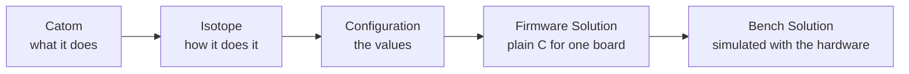
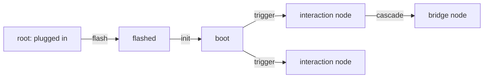

# How Polari works for hardware

Polari treats a circuit board the way it treats everything else: as objects you can see, connect and check, without writing code first. This page explains the ideas in plain words. The exact class name follows in backticks, so you can find it later. Parts that are still being built are marked "planned".

## Why hardware in Polari

Polari already lets you build things in the browser and on the backend by wiring boxes together instead of writing programs. Hardware uses the same idea and the same object tree. There is one no-code model, not a separate one for devices.

A single drawing (`CrossDomainSolution`) can hold a piece of firmware on a board, the link to the backend, a backend step that reacts, and a chart in the browser. Hardware only adds new kinds of box to the same canvas. The result you can always ask for is a real C project that builds with the normal tools, with or without Polari.

## Boards on the bench

A development board, a breadboard and a PCB you designed are all just Boards. How a board is known can differ: from its datasheet (`BoardDefinition`), from its geometry (`BoardModel`, whose instances on a bench are `BenchBoard` rows: a half breadboard, a full breadboard, the UNO), or from its copper layers and parts (`PcbBoard`, for example a KiCad import). None of these is privileged. The Bench level only cares about the points where things connect and what each point can drive or sense.

The Bench (`Bench`) is what is on the table: the boards, the breadboards, and the wires between their connection points. A step-by-step Workbench page helps you set one up by picking cards for breadboards and dev boards. Measuring instruments can be placed on the bench too, more than one if you like. A 4-channel oscilloscope is emulated, its probes are `ScopeChannel` rows, and its captures are `WaveformCapture` rows. Click a board to dive into its Board Details page.

## Firmware from small pieces

Polari reads a normal C project and breaks it into pieces. Four words matter:

| Word | Plain meaning | Class |
|---|---|---|
| Catom | what a piece of code does, with its inputs and outputs ("know when the button is pressed") | `CFunctionAtom` |
| Isotope | one way of doing that job. A different isotope is different code | `IsotopeVariant` |
| Configuration | the values the chosen isotope runs with. The code stays the same | `CatomConfiguration` |
| Variable | one named slot a configuration fills, such as a pin or a baud rate | `CatomVariable` |

Catom variables are Polari's generalised hardware abstraction layer. People enter datasheet facts for a board once, and the same catom then gets the right pin or clock value for each board.

Catoms are composed into a graph (`CGraph`), and Polari generates plain C from the graph (`FirmwareSolution`). Polari does not translate Python into C. The same compiled C runs in the simulator and on the device.

## Structs and bridges

The rule that keeps hardware testable: every hardware change lands in a struct, either on the device or on a bridge. A bridge is the link between a device and the backend. A Struct Object Map (`StructObjectMap`) turns a struct into a Polari object, so a field in the struct is an attribute you can see and use in no-code.

Catom assertions (`CatomAssertion`) say which code changes which field, which code reads it, and which pins a field drives. For example, a button press changes a field, and another catom reads that field to drive an LED pin. From these, Polari draws the route a signal takes, hop by hop.

The pin view (`/display/pin-view`) is a drawing of boards, chips and their pins. It shows what each pin can do, who uses it, and which pins nothing has claimed yet. It also has a blank state: how a chip looks before any firmware is flashed.

## Systems and Solutions

Two words separate a template from a finished result:

- A System is a template with choices still open: which isotope, which values, which board of a family. It is reusable and is never simulated as a whole on its own.
- A Solution has every choice made. It is bound to the other Solutions it is used with and is simulated as a whole.

There is a Hardware Solution, a Firmware Solution and a Thermal Solution. A Bench Solution (`BenchSolution`) is those three plus the bench conditions. For now the conditions are open air: natural convection and an ambient temperature range. A clip-on heat sink or a breadboard fan is allowed. Enclosures and venting come later. Making every System and Solution row exist is being built.

## Checking a configuration

Whether a configuration works depends on what it is used with. The same serial speed can be fine on one board alone and wrong when wired to another board that runs at a different clock. So Polari judges each option in a Bench Solution context (`ConfigOptionGrade`) and grades it:

- invalid: cannot work whatever else is chosen. It is never picked by default, and the build refuses it, with the reason shown.
- compromise: works but gives something up, always stated as a number (margin, throughput, a part, a rework step).
- ideal: passes every check with full margin.

Checks run cheapest first: a formula against a cited limit, then ranges derived from registers and conditions, then simulator runs. The default is chosen automatically, the best valid option, ideal above compromise. If a person chooses differently, the choice is recorded with what it gives up compared with the automatic one. If a later change makes the choice invalid, it is flagged.

When nothing the chip can do is enough, a fix suggester (planned) offers fixes cheapest first: other values, another isotope, a part, a third-party module board, another board. Each is tried in a copy of the bench first. Nothing is applied until a person accepts it.

The verdict engine and the Bench Solution row are built. The checks per variable group (clock first, then signal, drive and others), the catom page and the suggester are planned.

## Simulating a bench as Hardware Events (planned, being built)

Not continuous time, but a map of the states a bench passes through. Every path starts where the USB cable is plugged into the bridge.

- A node is a set of requirements on named struct fields: an exact value, a range, or a set of allowed values. Fields it does not name do not matter.
- An edge is what moves the bench to the next node, and it ends when those requirements are met, never by a clock. A trigger edge starts with an outside event (a press, a command from a bridge). A cascade edge follows from the previous change.
- The catoms and isotopes at a node decide how finely time is stepped there. A pin-change interrupt needs cycle steps, a serial byte needs a bit time. The page shows the step and what set it.
- Every test replays from the root. A node is confirmed when the run met its requirements and the expected catoms ran. Confirmations can come from simulation, from hardware, or from a person, and a confirmation is voided when the build changes.
- The data seen at the stepping lives only while an edge plays. What is kept is the assessment: when it was met, the durations, and each check's verdict.

## Temperature

A circuit is simulated at a temperature, using the temperature terms the circuit solver already has. All built:

- whole board: one background temperature for the circuit (`SpiceRun`);
- each part at its own temperature, from a datasheet coefficient or thermal model (`PartTemperatureBehaviour`, `PartThermalModel`);
- self-heating: the circuit is re-run as parts warm up, until it settles or is called a runaway;
- timing drift: a clock's rated band over a temperature range, and a serial link re-sampled bit by bit against that band.

## Where to look

- `/display/bench` shows the Bench and its boards. `/display/workbench` is the setup walkthrough.
- `/display/board-details` is one board's page, with tabs such as the thermal and self-heating ones.
- `/display/pin-view` is the pin drawing. `/display/bench-views` shows structs, their fields, the routes signals take and the bridges.
- `/display/catom` is the catom page with configurations and verdicts (planned).
- `/display/hardware-events` and `/display/structs` are the event and struct pages (planned).
